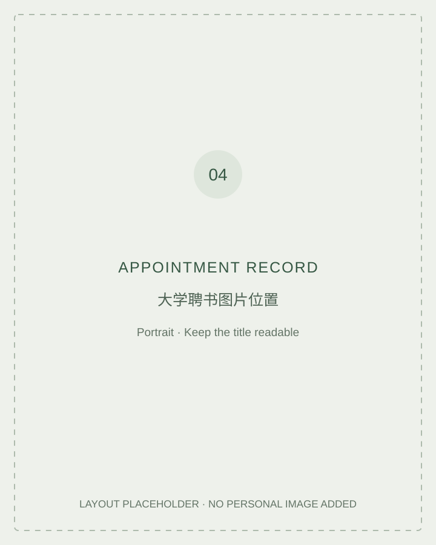
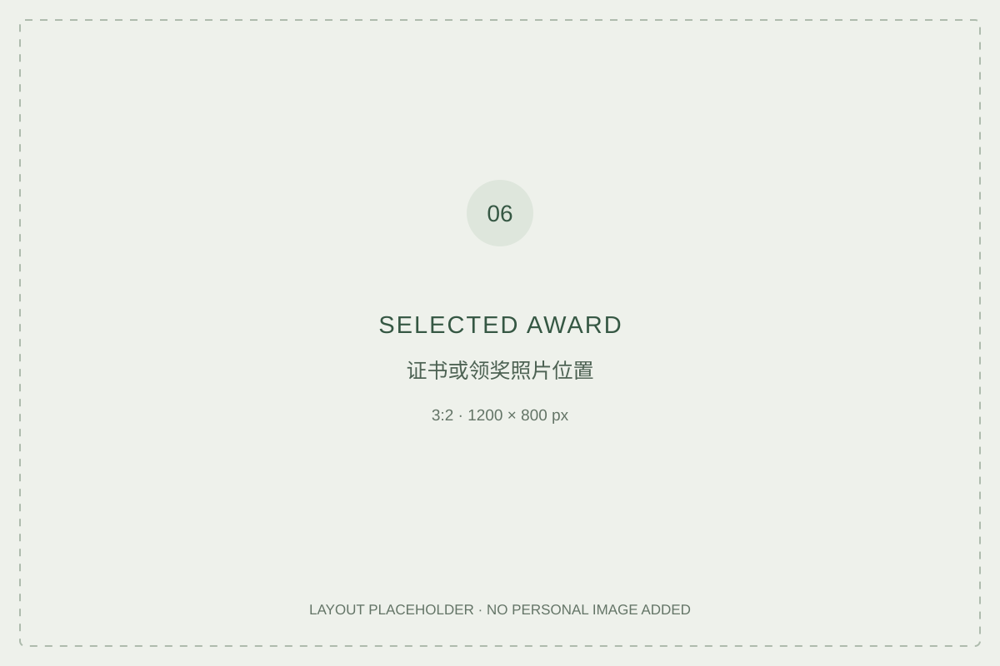
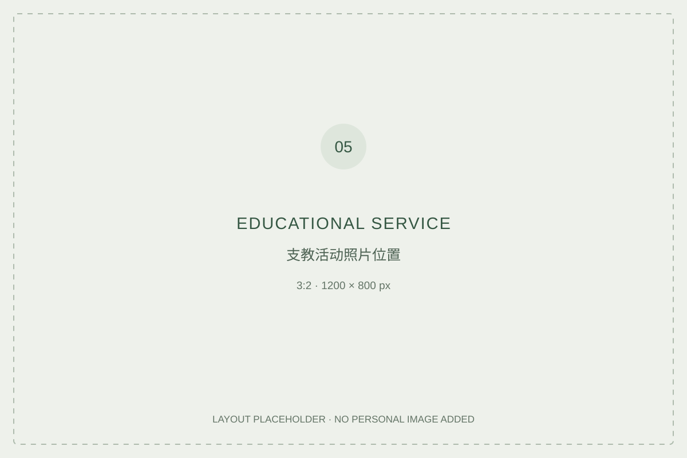

# Professional background

**Appointments, selected recognition & educational service**

> Framework only. Supporting documents and photographs have not yet been supplied.

## University appointment

**TEXT 07 — 60–100 words.** Record the institution, formal title in the appointment document, dates, scope and actual responsibilities. Give the source of each fact. Use an English rendering of the title that preserves its level and status.

## Selected recognition

**TEXT 08 — 30–50 words per award; select 3–5 awards.** Include the award name, awarding organisation, year, recipient and the applicant's contribution. Distinguish an award to the company from an award to the individual.

## Educational service

**TEXT 09 — 100–150 words.** Record when and where the activity took place, the organiser, the applicant's role and the work actually undertaken. Add a factual image caption. Any claim about outcomes needs its own evidence.

## Image captions & records

Every image should have a caption giving the event or document, date, source and role represented. Choose a publishable image; crop identifiers or use an appropriate non-identifying view where needed.

This repository will hold selected supporting records rather than a complete certificate archive.

---

[Back to profile](https://github.com/xuliangweiming)
